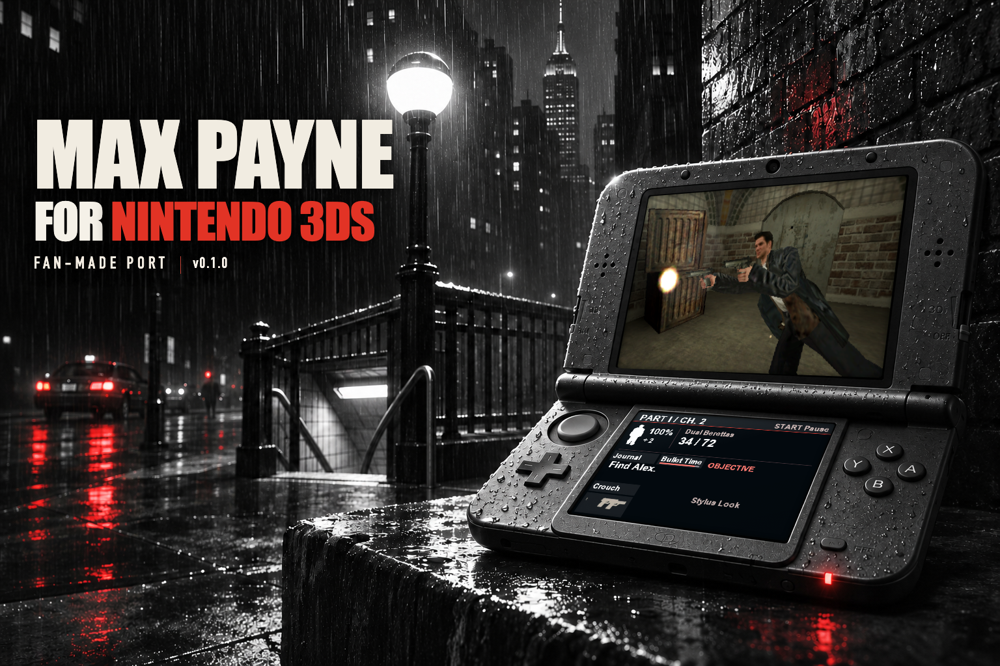

# ReMaxPayne-3ds



**ReMaxPayne-3ds** is a fan-made native Max Payne port that works on both **Old 3DS and New 3DS** through the Homebrew Launcher. Version **0.1.0** is an early-access build for testing on real hardware.

The repository contains the port source and conversion tools. Building the campaign requires your own compatible Xbox PAL copy.

## How it plays

The upper screen shows the third-person campaign, with optional stereoscopic 3D controlled by the console's slider. Move with the Circle Pad, slow down a firefight with Bullet Time, and press **L** while moving to shoot-dodge. The lower screen keeps health, ammunition, the Bullet Time meter, and your objective in view. Tap it to pick a weapon, crouch, or open Max's journal.

On **Old 3DS**, aim with the D-Pad or drag the stylus across the touch screen. Tap the Bullet Time meter to activate slow motion. On **New 3DS**, the C-Stick adds camera control and **ZL** toggles Bullet Time. The D-Pad and stylus also work on New 3DS.

From the main menu, choose **New Game** (`Новая игра`) to start the campaign or **Tutorial** (`Обучение`) to try the controls. The campaign supports autosaves and manual save slots. In the pause menu, **X** quicksaves and **Y** quickloads.

### Default campaign controls

| Action | Control |
| --- | --- |
| Move | Circle Pad |
| Aim and look | D-Pad, stylus drag, or C-Stick on New 3DS |
| Interact | A |
| Jump | B |
| Shoot-dodge | L while moving, with Bullet Time charge and a compatible weapon |
| Toggle Bullet Time | Touch-screen meter on Old 3DS or ZL on New 3DS |
| Fire | R, or ZR on New 3DS |
| Reload | X |
| Change weapon | Y or the touch-screen weapon picker |
| Crouch or stand | Touch-screen crouch button |
| Painkiller | SELECT |
| Pause | START |

### Graphic novel

Graphic-novel narration and artwork come from your Xbox copy. Large-text mode makes dialogue easier to read on supported Russian pages. **A** advances the text or page, **D-Pad Left and Right** move through the enlarged text, and **X** cycles through the available views. The current in-game interface is Russian. The English HUD labels in the poster are for the illustration.

## Build and install

Install devkitARM, libctru, Citro3D, FFmpeg, liblz4, and Python with Pillow and NumPy. Add the source directories of [dade](https://github.com/Tatsh/dade/tree/8fcd00aa194cfdbc1cee27fdf94c29502b012290) and [max_payne_sdk](https://github.com/m0nstr0/max_payne_ldb_importer/tree/708a64a3ff81c7ed645549ffcf3f451b91c5ba3d) to `PYTHONPATH`. Set `DEVKITPRO` to your SDK directory. On systems without a supported system font, set `MP_UI_FONT` to a TrueType font with Latin and Cyrillic glyphs.

Extract your disc image so that `game/default.xbe` and the `game/english/` data directory are present. The Xbox transition table packer checks for the PAL executable revision identified by SHA-256 `212c47d25f96b68996d085abf93cb43464b8cf34f156081b4919866a2be74102`.

```sh
python3 scripts/pack_native.py game build/native-assets
make campaign-assets
make native-full
make test
```

The campaign build writes `dist/native-full/3ds/maxpayne/maxpayne.3dsx`. Copy it to `3ds/maxpayne/maxpayne.3dsx` on your SD card and run it through the Homebrew Launcher. The game writes saves and settings beside the executable. Set `GAME_DISC` if you extracted the game to a different directory, and `ASSET_PYTHON` if your converters use a separate Python environment. The full 3DSX embeds your prepared game data and is intended for local use.

Max Payne and Nintendo 3DS are trademarks of their respective owners. This project is independent of the original publishers.
